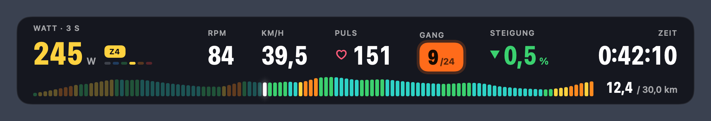
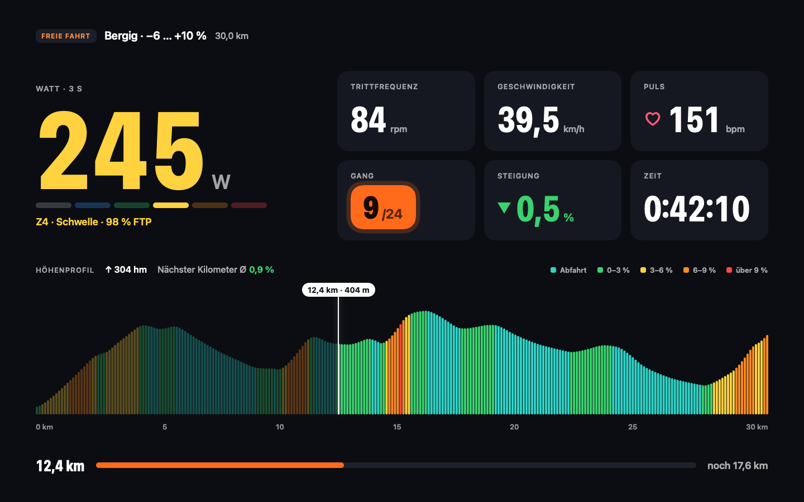
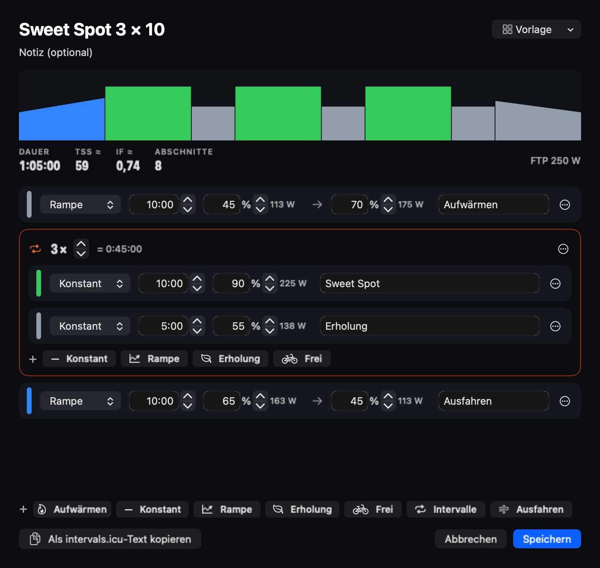
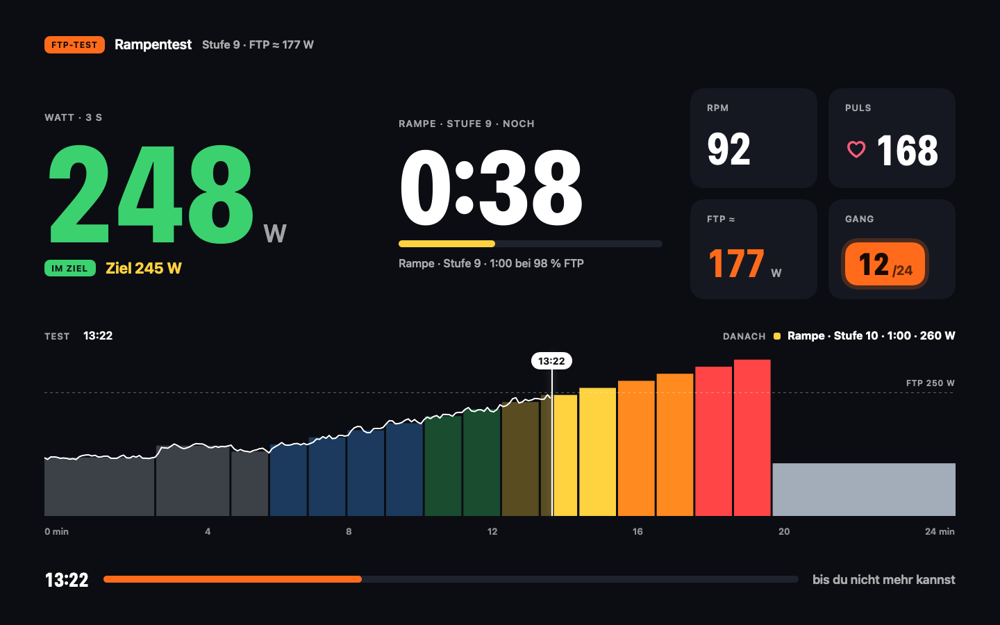
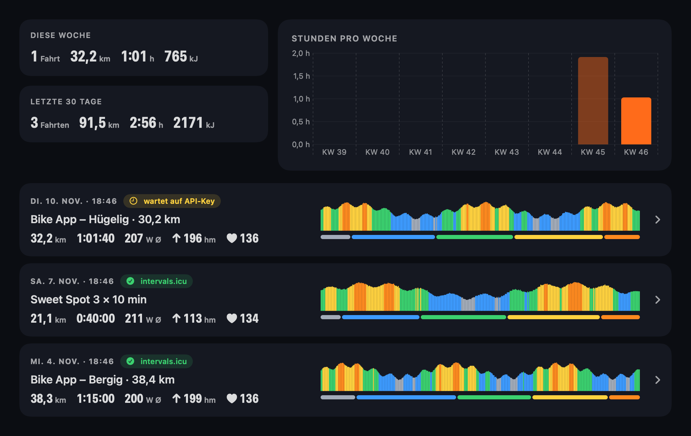

# Bike App

> **Ubuntu:** Eine Version für Ubuntu liegt im Ordner [`ubuntu/`](ubuntu/README.md). Das Installationspaket (.deb) gibt es unter Releases.

Native macOS-App für den Wahoo Kickr Core 2 (und Kickr Core) mit Zwift Cog und Zwift Click (v1 und neuer Click v2), ohne virtuelle Welt.

Während der Fahrt schwebt eine Leiste über allem, auch über Serien im Vollbild. Alternativ gibt es ein großes Dashboard im Vollbild.




## Bauen und starten

Voraussetzungen sind Xcode 26 und [XcodeGen](https://github.com/yonaskolb/XcodeGen) (`brew install xcodegen`).

```bash
xcodegen generate
xcodebuild -project BikeApp.xcodeproj -scheme BikeApp -destination 'platform=macOS' -derivedDataPath build/DerivedData build
open build/DerivedData/Build/Products/Debug/BikeApp.app
```

Alternativ `BikeApp.xcodeproj` in Xcode öffnen und ⌘R drücken. Tests laufen mit ⌘U oder mit `xcodebuild … test`.

Beim ersten Start fragt macOS nach Bluetooth-Zugriff: bitte erlauben.

Die App wird mit deinem Apple-Development-Zertifikat signiert (`project.yml`, `DEVELOPMENT_TEAM`). Dadurch bleibt ihre Identität bei jedem Neubau gleich. Schlüsselbund-Zugriff, Bluetooth und die Spotify-Steuerung musst du deshalb nur einmal erlauben.

## Erste Schritte

1. **Geräte:** Kickr, Click, Pulsgurt und Kadenzsensor werden beim ersten Fund automatisch gekoppelt. Unter „Geräte verwalten…“ lässt sich das ändern. Der Click darf nicht gleichzeitig mit Zwift oder der Zwift Companion App verbunden sein. Kein Gerät ist Pflicht, siehe „Fahren ohne alle Geräte“.
2. **intervals.icu:** In den Einstellungen den API-Key eintragen. Du findest ihn in intervals.icu unter *Settings › Developer Settings*. Als Athleten-ID reicht `0` für das eigene Konto. Der Key liegt im macOS-Schlüsselbund.
3. **Fahrer und Trainer:** Gewicht und FTP eintragen. Wenn intervals.icu für Radfahren eine FTP hat, wird diese genommen. Kettenblatt und Cog-Zähne sind nur der Startwert, die echte Übersetzung misst die App bei der ersten Fahrt.
4. **Ohne Hardware testen:** Den Demo-Modus in den Einstellungen oder in „Geräte verwalten…“ einschalten.

## Zwift Click v2 und Kickr Core 2

- **Click v2:** Er besteht aus zwei Bluetooth-Geräten. Die rechte Hälfte (+) erscheint als „Zwift Click“, die linke Hälfte (−) als „Click v2 links (−)“. Die App koppelt beide automatisch. Beide Hälften zusammen drücken pausiert wie beim alten Click.
- **Tasten zuordnen:** Standardmäßig schaltet jede Taste der rechten Hälfte schwerer und jede Taste der linken leichter. Unter „Geräte verwalten… › Click-Tasten › Tasten zuordnen…“ drückst du nacheinander die Taste für schwerer und für leichter. So geht es auch mit nur einer Hälfte.
- **Gesperrte linke Hälfte:** Zwift gibt die linke Hälfte nur für etwa 24 Stunden frei, nachdem sie mit der Zwift-App verbunden war. Ist sie gesperrt, zeigt die App „Gesperrt“. Dann den Click einmal kurz in der Zwift-App verbinden (ohne Abo), eine Taste drücken, Zwift schließen. Die rechte Hälfte funktioniert immer.
- **Wach halten:** Die Click-v2-Hälften schlafen sonst nach etwa einer Minute ein. Die App hält sie deshalb alle 3 Sekunden wach.
- **Kickr Core 2:** Die App erkennt das Modell und liest, was der Trainer kann. ERG-Ziele werden auf den erlaubten Leistungsbereich begrenzt. Kann ein Trainer keine Steigung simulieren, laufen die Gänge über ERG. Nach einem Verbindungsabbruch oder Reset bekommt der Trainer den aktuellen Widerstand sofort wieder.

## Fahren ohne alle Geräte

Du kannst immer starten, auch wenn Geräte fehlen:

| Fehlt | Was passiert |
| --- | --- |
| Click | Schalten mit den Gang-Knöpfen in der Leiste oder ⌃⌥↑/↓ |
| Trainer | Mit Kadenzsensor: Tempo aus Trittfrequenz und Gang, ohne Watt. Ohne Kadenz: Zeit und Puls laufen wie eine Stoppuhr |
| Trainer und Kadenz | Die Fahrt startet nach 5 Sekunden von selbst. Automatische Pause gibt es nicht, pausiere mit ⌃⌥P oder beiden Click-Tasten |
| Puls | Die Anzeige zeigt „–“ |

Bricht ein Gerät während der Fahrt ab, läuft die Fahrt weiter und das Gerät verbindet sich von selbst wieder.

## Fahren

- **Freie Fahrt:** Du wählst einen Steigungsbereich (Flach, Wellig, Hügelig, Bergig oder eigene Werte) und die Distanz oder Dauer. Das Höhenprofil wird zufällig erzeugt, „Neu würfeln“ erzeugt ein anderes.
- **Workout:** Eigene Workouts aus der App, dazu geplante Rad-Workouts der nächsten 7 Tage und die Workout-Bibliothek von intervals.icu. Drei Modi stehen zur Wahl:
  - **ERG · Click ±5 W:** Der Trainer hält die Zielwatt, Click verschiebt die Intensität.
  - **ERG · Click = Gang:** Der Trainer hält die Zielwatt, die Gänge wirken in Freifahrt-Abschnitten.
  - **Sim mit Zielen:** Du fährst das Höhenprofil, die Ziele werden nur angezeigt.
- **Schalten:** Click + schaltet schwerer, Click − leichter. Halten wiederholt den Schaltvorgang. 24 virtuelle Gänge, wie in Zwift.
- **Pause:** Beide Click-Tasten gleichzeitig drücken pausiert die Fahrt oder setzt sie fort. Das geht auch über den Pause-Knopf in der Leiste oder mit ⌃⌥P. Nach 3 s ohne Treten pausiert die Fahrt außerdem automatisch und läuft beim Antreten weiter.
- **Ziel ändern:** Bei freien Fahrten lässt sich das Ziel jederzeit ändern:
  - in der Leiste mit Ziel − / + (5 km oder 5 min)
  - im Menüleisten-Menü
  - im Hauptfenster unter „Ziel ändern“: Dort kannst du auch zwischen Distanz und Dauer wechseln.

  Eine längere Strecke wird weitergeneriert, das bisherige Profil bleibt erhalten.
- **Nach der Fahrt:** Die App sichert jede Fahrt sofort als FIT-Datei auf dem Mac (`~/Library/Application Support/BikeApp/Rides`). Danach lädt sie die Fahrt zu intervals.icu hoch. Bei Workouts aus dem Kalender wird sie dem geplanten Training zugeordnet. Ohne API-Key oder ohne Netz bleibt die Fahrt gesichert und wird automatisch nachgeladen:
  - sobald du den Key speicherst
  - beim nächsten Start der App
  - wenn du zur App wechselst

  Eine von Hand gesicherte FIT-Datei kannst du in den Einstellungen unter „FIT-Datei hochladen…“ nachreichen.

### Workouts erstellen

Unter „Neue Fahrt › Workout › Neues Workout“ öffnet sich der Editor:

- Abschnitte hinzufügen: Aufwärmen, Konstant, Rampe, Erholung, Frei, Intervalle (Wiederholungsgruppe) und Ausfahren.
- Jeder Abschnitt hat eine Dauer (z. B. `4:30` oder `10` für 10 Minuten) und eine Leistung in % FTP. Daneben steht die Wattzahl für deine FTP.
- Wiederholungsgruppen haben eine Anzahl und eigene Abschnitte.
- Über „…“ lassen sich Abschnitte verschieben, duplizieren und löschen.
- Oben gibt es Vorlagen (Sweet Spot, VO2max, Grundlage, Schwelle) und eine Vorschau mit Dauer, TSS und IF.
- „Als intervals.icu-Text kopieren“ legt das Workout in der Schreibweise von intervals.icu in die Zwischenablage.

Ein Workout aus intervals.icu lässt sich über „…“ in seiner Zeile als eigenes Workout kopieren und dann ändern. Eigene Workouts liegen in `~/Library/Application Support/BikeApp/Workouts.json`.



### FTP-Test

Unter „Neue Fahrt › FTP-Test“ gibt es zwei Tests:

- **Rampentest (ca. 20–30 min):** 5 Minuten Aufwärmen, dann steigt die Zielleistung per ERG jede Minute um etwa 6 % deiner FTP. Die Rampe endet, wenn du aufhörst zu treten, beide Click-Tasten drückst oder in der Leiste auf „Test beenden“ klickst. Sie endet auch, wenn die Trittfrequenz einige Sekunden unter 50 fällt oder die Watt deutlich unter dem Ziel bleiben. Danach folgen 5 Minuten Ausfahren. FTP = 75 % der besten Minute.
- **20-Minuten-Test (ca. 56 min):** Geführtes Aufwärmen mit Antritten und einer Vorbelastung, dann 20 Minuten ohne ERG. Dabei schaltest du selbst und fährst so gleichmäßig wie möglich. FTP = 95 % des 20-Minuten-Schnitts.

Leiste und Vollbild zeigen während des Tests die aktuelle Stufe und die geschätzte FTP.

Ein plausibles Ergebnis wird automatisch übernommen:
- **In der App:** als neue FTP.
- **In intervals.icu:** in den Sport-Einstellungen für Radfahren. Ist dort eine Indoor-FTP gesetzt, wird diese aktualisiert, sonst die FTP.

In der Zusammenfassung lässt sich das per „Rückgängig“ zurücknehmen. Ohne API-Key wird das Ergebnis übertragen, sobald du den Key einträgst. Einen zu kurzen oder abgebrochenen Test überträgt die App nur, wenn du ihn bestätigst.



### Historie

Im Hauptfenster unter „Historie“ stehen alle Fahrten:
- **Übersicht:** Kennzahlen für diese Woche und die letzten 30 Tage, dazu ein Balkendiagramm mit den Stunden pro Woche.
- **Liste:** Jede Fahrt zeigt Kennzahlen, den Leistungsverlauf in Zonenfarben, die Zeit in Zonen und den Upload-Status.
- **Detailansicht:** Ein Klick öffnet alle Werte und Kurven für Leistung, Puls und Höhe. Dort kannst du die Fahrt hochladen, als FIT exportieren oder vom Mac löschen.

Um Dateien musst du dich nicht kümmern. Die FIT-Datei braucht die App nur intern für intervals.icu. Über „Fahrt importieren…“ lassen sich FIT-Dateien aus anderen Quellen in die Historie holen.



### Musik (Spotify)

Die Steuerzeile in der Leiste zeigt, was Spotify spielt, und hat die Knöpfe Zurück, Play/Pause und Weiter. Die App steuert gezielt Spotify, nicht die allgemeinen Medientasten, deshalb pausiert eine Serie im Browser nicht mit. Beim ersten Knopfdruck fragt macOS, ob Bike App Spotify steuern darf.

Die Steuerzeile lässt sich in den Einstellungen unter „Anzeige“ ausblenden.

### Leiste

- Die Leiste lässt sich ziehen und über die **rechte untere Ecke größer oder kleiner** machen. Das Seitenverhältnis bleibt dabei erhalten, und Größe und Position werden gespeichert.
- Doppelklick wechselt ins Vollbild, Esc führt zurück zur Leiste.
- Mit ⌃⌥K wird die Leiste durchklickbar, damit Klicks den Videoplayer darunter erreichen.

### Tastenkürzel (systemweit)

| Kürzel | Funktion |
| --- | --- |
| Click + und − zusammen | Pause / weiter |
| ⌃⌥ ↑ / ↓ | Schalten (falls der Click fehlt) |
| ⌃⌥ P | Pause / weiter |
| ⌃⌥ F | Leiste ↔ Vollbild |
| ⌃⌥ B | Leiste ein / aus |
| ⌃⌥ K | Leiste durchklickbar |

Im Vollbild gehen auch ↑/↓, +/− und die Leertaste.

## Wie das Schalten funktioniert

Mit dem Zwift Cog dreht der Trainer immer im selben echten Gang. Die App rechnet für den gewählten virtuellen Gang aus, wie schnell das Rad auf der Straße rollen würde. Daraus bekommt der Kickr per FTMS eine passende Steigung, einen Rollwiderstand und einen Luftwiderstand. So fühlt sich ein schwererer Gang sofort schwerer an, ohne Verzögerung durch die App.

In den Einstellungen gibt es dazu zwei Regler:
- **Trainer-Schwierigkeit:** Standard ist 50 % wie in Zwift.
- **Widerstand:** Statt der Simulation lässt sich ein ERG-Verfahren wählen.

## Projektstruktur

```
BikeApp/
  App/       App-Start, zentraler Zustand, Einstellungen, Tastenkürzel
  BLE/       Bluetooth: Kickr (FTMS), Zwift Click v1/v2, Puls, Kadenz, Demo-Trainer
  Ride/      Fahr-Engine, Physik, Gänge, Höhenprofil, Aufzeichnung
  Workout/   Workout-Modell, eigene Workouts und intervals.icu-Parser
  Intervals/ REST-Client und Schlüsselbund
  Export/    FIT-Datei und Fahrten-Speicher mit Nachladen
  Music/     Spotify-Steuerung
  UI/        Leiste, Vollbild, Startfenster, Workout-Editor, Einstellungen
BikeAppTests/ Tests für Parser, Physik, Profil, FIT, Engine und gerenderte Ansichten
```

## Bekannte Grenzen

- **Zwift Click v1:** Die App nutzt den unverschlüsselten Handshake. Verlangt der Click Verschlüsselung (ältere Firmware), zeigt die App das an. Dann die Firmware über die Zwift Companion App aktualisieren.
- **Zwift Click v2:** Zwift hat das Protokoll nicht veröffentlicht. Die Umsetzung folgt Open-Source-Projekten (qdomyos-zwift, Torqa, makinolo.com). Welche Bits welche Taste sind, ist dort nicht eindeutig, deshalb gibt es die Tasten-Zuordnung. Die linke Hälfte braucht die Freigabe durch Zwift (siehe oben).
- **Ohne Trainer:** Die Fahrt speichert 0 W als Leistung.
- **Hardware:** Mit echter Hardware wurde die App noch nicht getestet. Kickr, Click und die Sensoren sind nach den Bluetooth-Spezifikationen und bekannten Protokollen umgesetzt.
